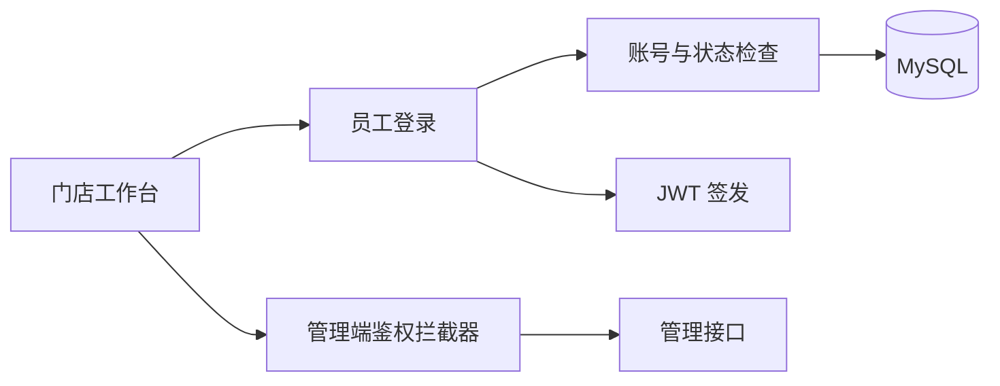

# MealFlow

### 餐饮订单与门店运营平台

以门店工作台为入口，围绕员工身份、商品信息、订单处理与经营分析组织后端模块。当前版本先完成员工登录与管理端鉴权，其余业务模型作为后续订单链路的基础。

**Java 17 · Spring Boot · MyBatis · MySQL · JWT · Maven 多模块**

[当前能力](#当前能力) · [快速启动](#快速启动) · [接口入口](#接口入口) · [工程记录](docs/engineering-notes.md) · [验证记录](docs/verification.md)

## 当前能力

| 领域 | 实现状态 |
| --- | --- |
| 员工登录 | 按用户名查询员工，检查密码与账号状态，签发 JWT |
| 管理端鉴权 | 拦截管理接口并验证 Token；登录入口放行 |
| 接口基础 | 统一结果封装、业务异常处理、Knife4j 文档 |
| 商品、订单、用户、经营报表 | 已有部分实体和 DTO / VO，业务接口尚未完成 |
| 下单、支付、配送、订单超时 | 后续路线图 |

Redis、微信支付和对象存储相关依赖或工具类的存在，不代表这些业务已接通。

## 系统结构



```text
mealflow-common/   统一响应、异常、配置属性与基础工具
mealflow-model/    员工、商品、订单等实体和数据传输对象
mealflow-server/   Controller、Service、Mapper 与启动入口
docs/             工程决策和验证记录
```

三个模块共享 `io.github.spylent1.mealflow` 包前缀。公共能力、业务模型与接口实现分别维护，避免模型与 Web 层相互耦合。

## 快速启动

准备 JDK 17、Maven 3.9 和 MySQL。

```powershell
git clone https://github.com/spylent-1/mealflow.git mealflow
cd mealflow
$env:DB_PASSWORD = "你的本地数据库密码"
$env:JWT_ADMIN_SECRET = "替换为足够长的本地随机密钥"
mvn clean install
mvn -pl mealflow-server spring-boot:run
```

数据库默认为 `mealflow`，可以使用 `DB_NAME` 连接已有开发库。当前仓库未附完整建表和初始化脚本，需要先准备与实体匹配的数据库；因此上述命令不是零配置启动保证。`.env.example` 仅用于参考，需要把变量导入终端。

默认服务地址 `http://localhost:8082`，接口文档 `http://localhost:8082/doc.html`。

## 接口入口

```http
POST /admin/employee/login
Content-Type: application/json

{"username":"你的开发账号","password":"你的开发密码"}
```

成功响应包含 `data.token`，后续管理请求使用 `token: <JWT>` 请求头。

`POST /admin/employee/logout` 当前返回成功响应，但没有撤销已签发 Token；完整退出语义尚待实现。当前开发版登录直接比较数据库密码，不适合作为生产账号体系，后续需要引入密码哈希与迁移策略。

## 工程实践

- 从独立源码分支整合后端工程，默认页面可直接查看源代码与启动入口。
- Maven 坐标、模块目录、Java 包、Mapper namespace 与接口文档统一命名。
- 数据库密码与 JWT 签名密钥通过环境变量配置；登录日志不输出密码和完整 Token。
- 以 Mapper XML 绑定、配置前缀、登录异常分支和 JWT 鉴权测试验证迁移。

## 验证与路线图

```bash
mvn verify
```

构建和测试状态见[验证记录](docs/verification.md)。

- [ ] 完成数据库迁移脚本与可复现的开发数据。
- [ ] 商品可售状态、库存、下单与接单的完整链路。
- [ ] 订单取消、超时关闭、重复请求与状态流转校验。
- [ ] 支付与退款联调，使用明确的开发环境证据记录结果。
- [ ] 真实业务链路完成后，再评估缓存、异步解耦与并发优化。

## 来源

从苍穹外卖教学工程演进，保留现有 MIT 许可证和原作者权益。个人整理与后续开发记录见 [NOTICE](NOTICE.md) 和[工程记录](docs/engineering-notes.md)。
